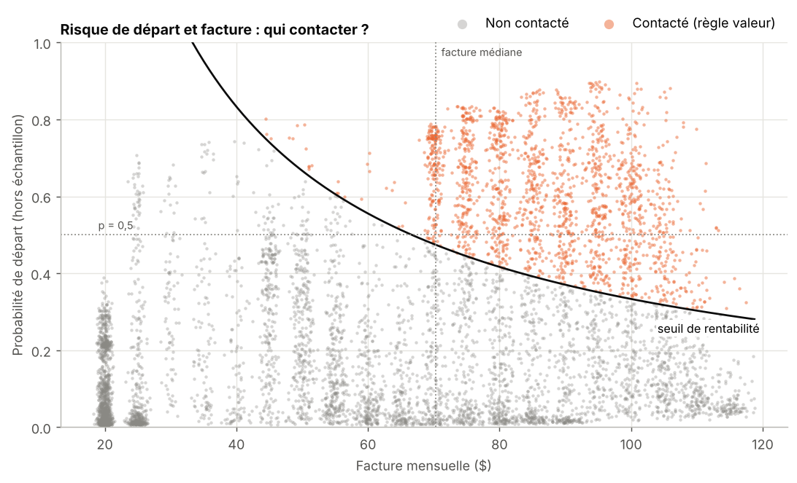
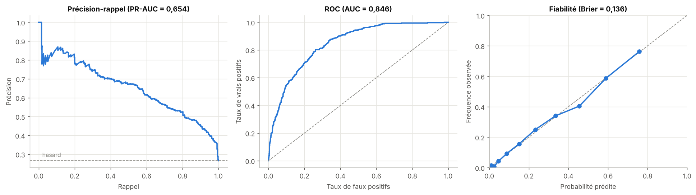

# Attrition client : qui contacter, et est-ce rentable ?

Analyse du jeu public Telco Customer Churn (IBM) : 7 043 clients d'un opérateur télécom. Le projet va de l'audit des données jusqu'à une règle de contact chiffrée en dollars, avec un plan de test pour vérifier l'hypothèse dont tout dépend.

Notebook complet, exécuté avec toutes ses sorties : [notebooks/analyse_attrition_clients.ipynb](notebooks/analyse_attrition_clients.ipynb)

## La question

Un opérateur veut proposer une offre de rétention aux clients susceptibles de partir. Chaque contact coûte 60 $ (geste commercial et temps du conseiller), et l'équipe ne peut pas appeler tout le monde. Qui faut-il contacter, et quel profit attendre ?

Hypothèses de travail, explicites et testées dans le notebook : l'offre fait rester 30 % des futurs partants contactés, la marge représente 50 % de la facture, et un départ évité rapporte 12 mois de facturation.

## Conclusions métier

**1. Trois facteurs dominent : le contrat, l'ancienneté et la fibre.** 43 % des clients sans engagement partent, contre 3 % avec un engagement de deux ans. Les clients arrivés depuis six mois ou moins (21 % de la base) partent à 53 %. Les trois méthodes d'interprétation utilisées (coefficients, permutation, SHAP) placent ces variables en tête.

**2. La fibre pose un problème à part entière.** À contrat égal, ses clients partent nettement plus que ceux de l'ADSL (55 % contre 32 % sans engagement), alors qu'ils paient 25 $ de plus par mois. Dans un modèle explicatif, la fibre multiplie la cote de départ par 2,62 (IC 95 % : 2,20 à 3,11) à profil égal. C'est une question pour l'équipe produit : prix, qualité du réseau ?

**3. Il faut contacter selon le gain espéré, pas selon le risque seul.** La règle retenue : contacter si probabilité de départ × taux de rétention × valeur du client ≥ coût de l'offre. Conséquence directe : un client facturé moins de 33,33 $ par mois ne justifie jamais l'offre, même s'il est certain de partir.

**4. Résultat sur le jeu de test.** La règle contacte 363 clients sur 1 409 (26 %) et touche 212 des 374 partants. Profit attendu : 10 732 $ [IC 95 % : 7 742 $ à 13 622 $]. Contacter tout le monde donnerait −35 553 $.

**5. Tout dépend du taux de rétention de l'offre.** Si elle retient moins de 20 % des partants contactés, la campagne perd de l'argent. Un test A/B de 286 clients par groupe suffit à détecter un effet de cette taille, et tient en une seule vague.



*Chaque point est un client, avec sa probabilité de départ estimée hors échantillon. La courbe noire est la frontière de rentabilité de l'offre : plus la facture est élevée, plus un risque modéré suffit à justifier un appel.*

## Recommandations

| Priorité | Action | Appui |
|---|---|---|
| 1 | Tester l'offre par A/B (286 clients par groupe) avant tout déploiement | perte sous 20 % de rétention |
| 2 | Contacter selon la règle valeur, en commençant par le segment risque élevé et facture élevée | 50 % de la facturation à risque pour 17 % des clients |
| 3 | Concentrer l'effort sur les six premiers mois et proposer un contrat engageant | 53 % de départs dans les six premiers mois |
| 4 | Analyser la fibre avec l'équipe produit | cote de départ × 2,6 par rapport à l'ADSL |
| 5 | Prévoir une action moins coûteuse pour les petites factures | offre jamais rentable sous 33,33 $ par mois |

## Performances du modèle

| | |
|---|---|
| Modèle retenu | Régression logistique, pénalité L1 |
| PR-AUC (test) | 0,654 [IC 95 % : 0,601 à 0,704], pour 0,265 au hasard |
| ROC-AUC (test) | 0,846 [IC 95 % : 0,824 à 0,867] |
| Score de Brier (test) | 0,136 ; écart moyen de 1,2 point entre probabilité prédite et fréquence observée |
| Gradient boosting réglé | PR-AUC 0,666 contre 0,665 en validation croisée, écart non significatif (p = 0,80) |



## Démarche

- **Qualité des données.** Les 11 valeurs vides de `TotalCharges` sont les 11 clients d'ancienneté 0, jamais facturés : remplacées par 0. La facture mensuelle découle presque exactement des services souscrits (R² = 0,9988) ; je la retire du modèle pour garder des coefficients lisibles.
- **Exploration.** Taux de départ par segment, tests du chi² avec V de Cramér et correction de Benjamini-Hochberg, tests de Mann-Whitney avec delta de Cliff. Le genre n'a aucun lien avec le départ (p = 0,49) et n'est pas utilisé.
- **Choix des variables.** Comparaison de quatre jeux de variables en validation croisée répétée, avec des tests appariés corrigés (Nadeau et Bengio) pour tenir compte de la dépendance entre plis.
- **Choix du modèle.** Régression logistique, forêt aléatoire, gradient boosting ; réglage par recherche aléatoire ; règle de choix fixée avant de voir les résultats.
- **Déséquilibre.** Pas de rééquilibrage : la pondération des classes gonfle les probabilités (Brier 0,134 → 0,163), alors que la règle de contact en a besoin telles quelles.
- **Calibration.** Vérifiée sur des prédictions hors échantillon ; aucune recalibration n'est utile.
- **Décision.** Règle valeur comparée à un seuil de probabilité optimisé, puis évaluée une seule fois sur le jeu de test, avec bootstrap du profit. Analyse de sensibilité aux hypothèses économiques et à la capacité d'appel.
- **Segmentation.** Croisement risque × facture sur toute la base, avec une action proposée par segment.
- **Interprétation.** Odds ratios, importance par permutation, SHAP, et un modèle explicatif (statsmodels) avec intervalles de confiance.
- **Robustesse.** Analyse des erreurs, performance et calibration par segment, courbe d'apprentissage.
- **Plan de test A/B.** Taille d'échantillon par calcul de puissance.

## Limites

- Le modèle prédit qui part ; il ne mesure pas l'effet d'une action. Le type de contrat reflète sans doute l'intention initiale du client autant qu'il la façonne.
- Les hypothèses économiques ne sont pas mesurées. Le résultat dépend surtout du taux de rétention, que seul un test peut établir.
- Le fichier est une photographie : les clients partis avant l'extraction n'y figurent pas, ce qui empêche une analyse de survie fiable.
- Le jeu est en partie synthétique (taux de départ élevé, facture issue d'une grille exacte). La méthode se transpose ; les chiffres, non.

## Reproduire l'analyse

Python 3.11 ou plus récent (testé avec Python 3.13).

```bash
git clone https://github.com/aymenben011/Prediction_attrition_clients.git
cd Prediction_attrition_clients

python -m venv .venv && source .venv/bin/activate   # Windows : .venv\Scripts\activate
pip install -r requirements.txt

jupyter lab notebooks/analyse_attrition_clients.ipynb
```

L'exécution complète prend environ une minute et demie. Les graines aléatoires sont fixées : avec les versions indiquées dans `requirements.txt`, deux exécutions donnent les mêmes résultats. Les chiffres clés sont exportés dans `resultats/metriques.json`.

```
Prediction_attrition_clients/
├── notebooks/analyse_attrition_clients.ipynb   # analyse complète
├── data/telco_customer_churn.csv               # 7 043 clients, 21 colonnes
├── figures/                                    # figures exportées par le notebook
├── resultats/metriques.json                    # chiffres clés
├── requirements.txt
└── README.md
```

## Données et licence

Telco Customer Churn, publié par IBM comme jeu d'exemple ; les montants sont en dollars. Le jeu de données appartient à IBM. Code sous licence MIT (voir [LICENSE](LICENSE)).
